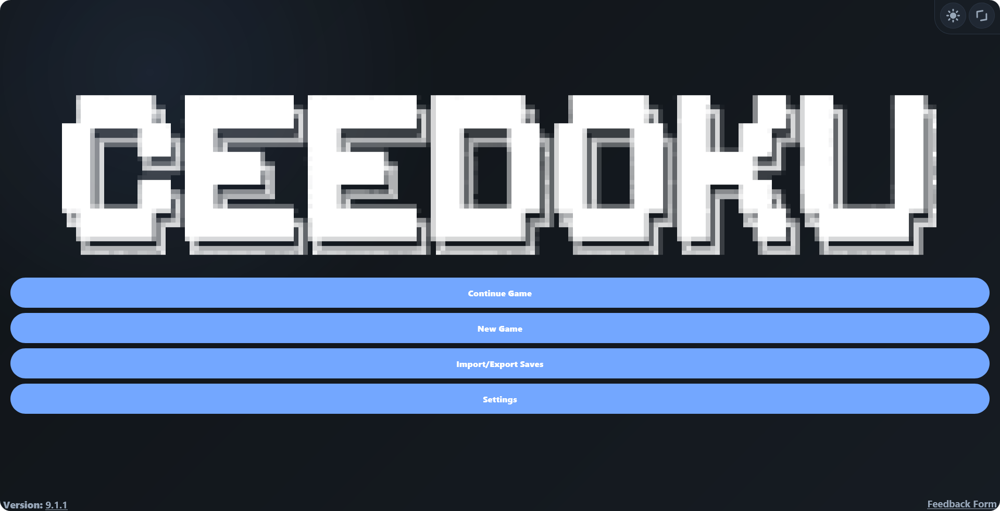

# Hey, I'm Ceebug!

I enjoy building things for the web, making Minecraft mods (as well as resource packs), and experimenting with new ideas. You can have a look at my development portfolio [here](https://ceebug.is-a.dev), or explore some of my projects below!

## Projects

### Ceedoku

> A free, lightweight Sudoku game with multiple difficulties, saving, hints, tools, animations, sound, haptics, and more.
>
> **What it looks like:**
> 
>
> **Made with:** HTML, CSS, JavaScript, Electron

    

### JSF

> A lightweight JavaScript parser for [Ceedoku Save Format (`.CSF`)](https://ceedoku.github.io/csfspec) files. JSF reads CSF files and converts their contents into usable data.
>
> **Made with:** JavaScript

 

### FSJ

> A lightweight JavaScript serialiser for [Ceedoku Save Format (`.CSF`)](https://ceedoku.github.io/csfspec) files. FSJ takes data and creates a valid CSF save file from it.
>
> **Made with:** JavaScript

 

### Pixelmoji

> A Minecraft mod that adds proper emoji support to the game.
>
> **Made with:** Java, JSON
>
> This mod's code is AI-generated because it is intended to function like a texture pack, but has to be a mod since resource packs cannot accomplish this (properly).
>
> *Still under review on Modrinth.*

   

### Teal Main Menus

> A Minecraft resource pack that gives the game's menus and hotbar a teal makeover, including buttons, sliders, inventory screens, and more.
>
> **Made with:** JSON, PNG

 

### Ceebug's Rounded Hotbar

> A Minecraft resource pack that gives every hotbar slot rounded corners to match the off-hand slot, making the HUD more visually consistent.
>
> **Made with:** JSON, PNG

 

### Diamond Upgrade Templates

> A Minecraft mod that adds Diamond Upgrade Templates and Diamond Ingots, allowing you to upgrade iron armour and tools into diamond gear while keeping their durability, enchantments, and trims.
>
> **Made with:** Java, JSON

 

### Useful Recipe Book

> A Minecraft mod that adds a craftable recipe book, allowing players to unlock every recipe in the game.
>
> **Made with:** Java, JSON

 

### NiceNav

> A Firefox style modification that makes window navigation controls look exactly the same when hovered over as any other button that lives on the browser chrome right next to them.
>
> **Made with:** CSS

 

### NiceTabs

> A Firefox style modification that adds some spacing to the left of the open tabs.
>
> **Made with:** CSS

 

### NiceToolbar

> A Firefox style modification that makes the history buttons aligned properly on the toolbar.
>
> **Made with:** CSS

 

### NiceOneLine

> A clean, minimalist patch for modern Firefox that forces the navigation bar and tabs into a single, seamless row.
>
> **Made with:** CSS

 

## Stats

  
  
  
  

## Socials

###  Spotify

 

###  Gravatar

 

###  Patreon

 

###  Modrinth

 

###  Discord

 

###  SoundCloud

 
